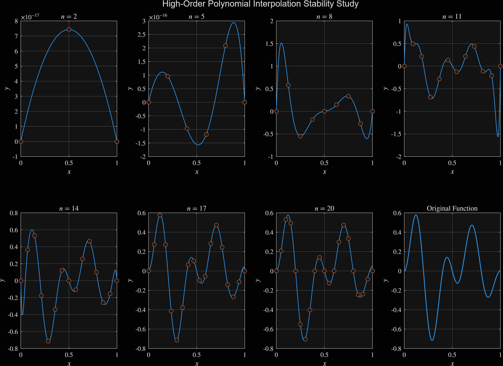
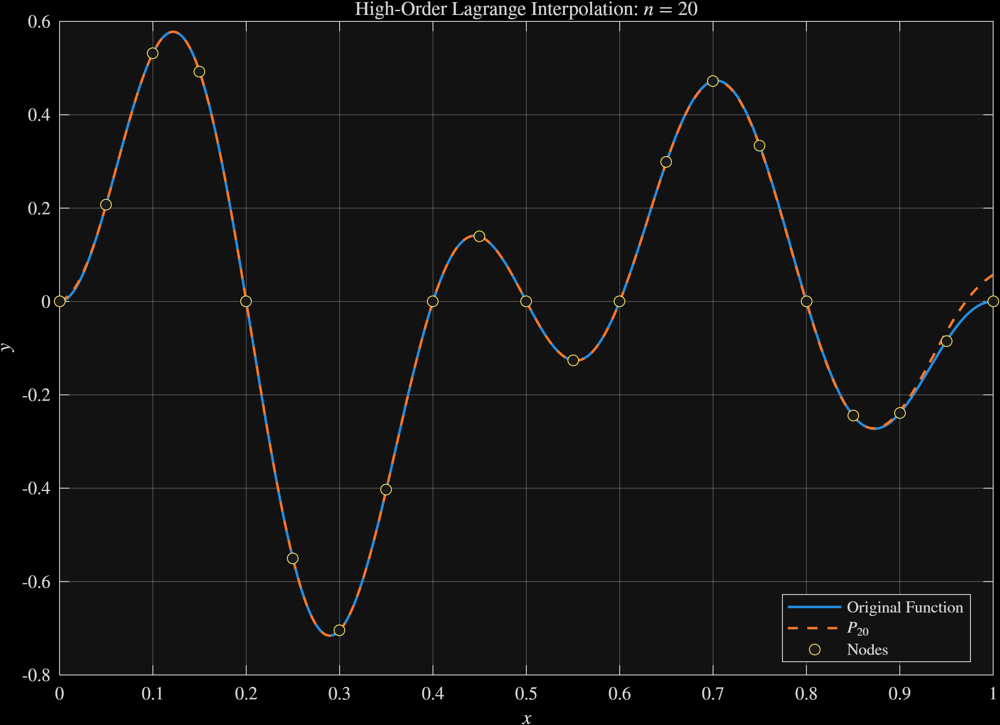
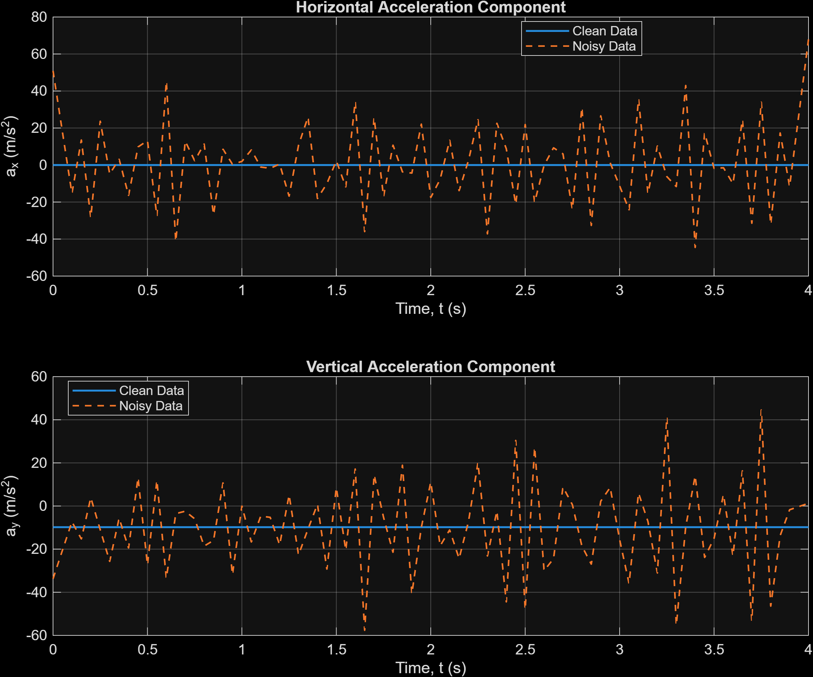

# Numerical Interpolation and Data Analysis

**MATLAB · Numerical methods · Simulation and error analysis**

I built reusable MATLAB functions for polynomial interpolation, polynomial and derivative evaluation, centered finite differences, and sinusoidal least squares fitting. I then used them to examine a practical question: when does a numerical result look convincing but still need an error check? The figures below come from my MATLAB runs. The projectile positions are reproducible synthetic data, rather than experimental measurements.

## Project at a glance

| Study | Question | Evidence |
| --- | --- | --- |
| Polynomial interpolation | How does increasing degree change the fit to an oscillatory function? | Degree comparison and degree-20 overlay |
| Numerical differentiation | How does step size affect a derivative estimate? | Estimates compared with symbolic derivatives |
| Projectile motion | What happens when position noise is differentiated? | Clean and noisy acceleration estimates |

## Numerical approach

I implemented Lagrange interpolation to construct polynomial coefficients from nodes and Neville's method to evaluate an interpolant at a chosen point. Horner's method evaluates a polynomial and its derivative efficiently; I checked it against MATLAB's `polyval` and `polyder`. For derivatives of other functions, I used the centered difference formula `(f(x+h)-f(x-h))/(2h)` and reduced `h` by a factor of ten. For a periodic signal, I fit a constant and sine and cosine harmonics with a least squares design matrix.

These tools solve different problems. In particular, agreement between two consecutive numerical estimates is a useful stopping signal, but it does not prove that either estimate is accurate.

## Study 1  Polynomial interpolation

*Figure 1. Interpolants at several degrees for a selected oscillatory function. Each panel has its own vertical scale.*

The low-degree curves miss important features. As the degree increases, the curves represent more of the target's oscillations. Because the panel scales differ, their heights cannot be compared directly.

*Figure 2. The degree-20 interpolant closely tracks this target on the plotted interval.*

This close match is specific to the chosen function and nodes. Higher degree can also introduce instability, especially when explicit polynomial coefficients and equally spaced nodes are used. I would test error on a dense grid before relying on a high-degree model elsewhere.

## Study 2  Derivative convergence

For two nonlinear examples, I compared centered differences with derivatives computed by MATLAB's Symbolic Math Toolbox. In the run shown, at `h = 10^-6`, the true relative errors were approximately `2.13 × 10^-11` and `1.24 × 10^-11`. The errors decreased substantially from the initial `h = 1`. These are results for those specific functions and evaluation points; making `h` smaller indefinitely can eventually worsen floating-point cancellation.

## Study 3  Noisy projectile positions

I generated an ideal trajectory with launch speed 25 m/s, launch angle 40°, gravity 9.81 m/s², and a fixed random seed. I added Gaussian position noise with standard deviation 0.02 m, then estimated velocity and acceleration from both data series using finite differences.

*Figure 3. Clean acceleration is close to the ideal values; the acceleration calculated from noisy positions fluctuates sharply.*

The clean horizontal acceleration stays near zero and the clean vertical acceleration near −9.81 m/s². The noisy estimates fluctuate much more than the positions themselves. Second differences amplify small measurement errors, so reporting a single acceleration estimate from noisy positions would need additional smoothing or uncertainty analysis.

## What I learned

A smooth plot and a small change between iterations can be reassuring without being sufficient evidence of accuracy. This project helped me connect numerical formulas to testable code, check results against known references, and explain where numerical methods become sensitive to data quality or parameter choices.

**Reproduce the work:** In MATLAB, from the repository root, run `addpath('src')`, `run_smoke_tests`, `generate_demo_data`, `projectile_trajectory_modeling`, `INTERPOLATION_Analysis`, and `Differentiation_Error_Analysis`. The final script requires the Symbolic Math Toolbox. MATLAB writes the figure files to `results/`. The selected portfolio images are preserved in `figures/`.
