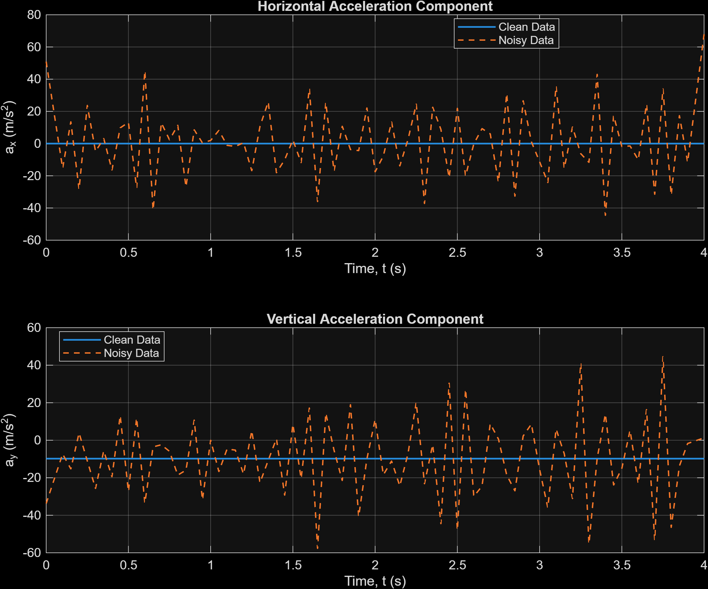
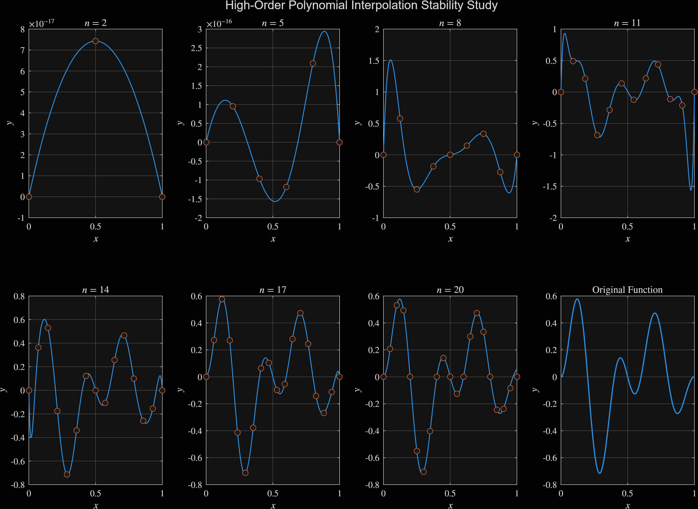
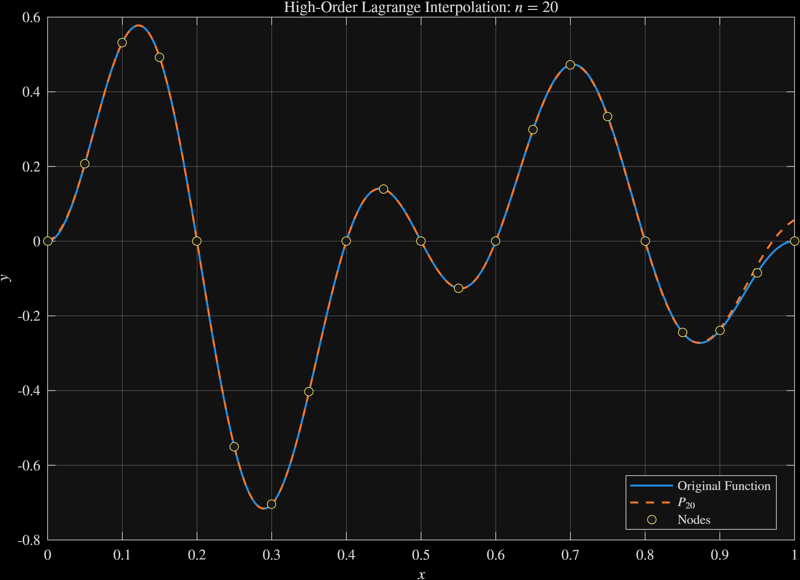

# Numerical Interpolation and Data Analysis

A MATLAB project exploring how numerical methods behave when evaluating functions, estimating derivatives, fitting periodic signals, and analyzing a simulated projectile trajectory. The main theme is **accuracy**: what changes as the polynomial degree, number of interpolation nodes, or finite-difference step size changes?

## What I built

| Component | What it does | Main files |
| --- | --- | --- |
| Polynomial interpolation | Builds Lagrange interpolants, evaluates them with Horner's method, and compares smooth and higher-degree examples | `Lagrange_Interpolation_Method.m`, `INTERPOLATION_Analysis.m`, `Horner_Polynomial_Evaluation.m` |
| Neville interpolation | Evaluates an interpolant directly and refines the node grid while comparing estimates | `Neville_Interpolation_Method.m`, `Neville_Function_Evaluation.m`, `NEVILLE_Method_Analysis.m` |
| Numerical differentiation | Estimates derivatives with centered differences and compares results across step sizes | `Numerical_Differentiation.m`, `Differentiation_Error_Analysis.m` |
| Periodic signal fitting | Fits a constant plus sine and cosine harmonics by least squares | `Sinusoidal_Model_Fitting.m` |
| Projectile motion | Computes velocity and acceleration from sampled positions, then compares clean and noisy simulated data | `projectile_trajectory_modeling.m`, `generate_demo_data.m` |

All MATLAB source files are in [`src/`](src/). `Differential_error_analysis.m` is an alternate derivative study with the same three function families.

For a narrative walkthrough of the methods and findings, read the [project case study](CASE_STUDY.md).

## Selected results

These figures were exported from a MATLAB run. The full set of 14 plots is in [`results/`](results/) and can be regenerated using the commands below.

### Noise and numerical differentiation



The simulated clean trajectory has horizontal acceleration near zero and vertical acceleration near −9.81 m/s². Small added errors in position become large fluctuations after taking second differences. The noisy curve is a demonstration of noise amplification; it is not a measured projectile experiment.

### Interpolation as degree increases



The sample points are interpolated at each degree. Low-degree interpolants miss parts of the oscillatory target function, while higher degrees capture more of its structure. The panels use different vertical scales, so visual height across panels should not be compared directly.



At degree 20, the interpolant closely follows this particular target function on the plotted interval. This example does not establish that higher degree is always better for other functions or nodes.

## Run it

Requires MATLAB. The derivative analysis scripts also require the **Symbolic Math Toolbox**. The projectile example uses `readmatrix`, `writematrix`, and `exportgraphics`; use a MATLAB release supporting these functions.

1. Clone or download this repository and open MATLAB.
2. Set **Current Folder** to the repository root and run:

   ```matlab
   addpath('src')
   run_smoke_tests
   generate_demo_data
   projectile_trajectory_modeling
   INTERPOLATION_Analysis
   Horner_Method_Validation
   NEVILLE_Method_Analysis
   Differentiation_Error_Analysis
   ```

3. The projectile and interpolation figures appear in `results/`. The generator writes two reproducible synthetic CSV files to `data/`. Sample CSV files and exported PNGs from a MATLAB run are included in this repository; rerunning the scripts replaces them. You can also substitute your own **uniformly spaced** time series with three columns in the order `time, x, y` using the same CSV names.

`run_smoke_tests` checks several known polynomials, a quadratic derivative, and a known sinusoidal signal. It does not run the figure-producing scripts or the symbolic examples.

## Method notes

- **Lagrange / Neville:** both represent the polynomial through given nodes. Neville evaluates at one point without first constructing the coefficient vector. Explicit high-degree polynomial coefficients can be poorly conditioned, especially with equally spaced nodes.
- **Horner:** evaluates the polynomial and its derivative through nested multiplication; `Horner_Method_Validation` compares these outputs with `polyval` and `polyder`.
- **Finite differences:** a smaller step initially reduces truncation error, but a very small step can amplify floating-point cancellation. Approximate error between successive estimates does not prove closeness to the exact derivative.
- **Sinusoidal fit:** uses a design matrix and MATLAB's backslash operator for least squares. The sampled period is `N × Δt`, treating the final sample as the last distinct point before the cycle repeats. Excessive or unidentifiable harmonics are rejected.
- **Projectile motion:** samples a simple ideal trajectory with initial speed 25 m/s, angle 40°, gravity 9.81 m/s², and seeded Gaussian position noise with standard deviation 0.02 m. Differentiating noisy positions amplifies noise, especially in acceleration. These are **synthetic demonstration data**, not measured observations.

## Project structure

```text
src/       MATLAB functions, analyses, smoke tests, demo data generator
data/      reproducible synthetic CSV inputs
results/   complete set of MATLAB output plots
figures/   selected MATLAB output for the README and portfolio
CASE_STUDY.md   narrative version for a portfolio website
```

## Scope and limitations

The interpolation experiments illustrate numerical behavior for chosen functions and intervals; they do not guarantee accuracy for arbitrary functions. The adaptive Neville stopping rule compares successive full-grid estimates, so agreement can occur even when the true error remains large. The projectile model assumes uniformly spaced observations and ideal motion without drag. The plots shown above were supplied after a MATLAB run; the reusable functions also passed the included smoke tests in that run.
